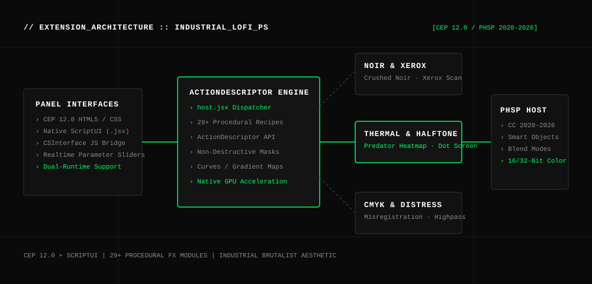

# INDUSTRIAL-LOFI-PS // PROCEDURAL_FX_PANEL

[](LICENSE)
[](https://github.com/therealfullmetal55555/industrial-lofi-ps)
[](CSXS/manifest.xml)
[](scripts/simulate_extension.py)

> **Industrial Grunge, Halftone, Thermal Heatmap & Raw Procedural FX Panel for Adobe Photoshop (CC 2020–2026).** Features dual runtime integration (HTML5 CEP 12.0 panel + standalone ScriptUI `.jsx` panel) with 29+ non-destructive ActionDescriptor recipes: crushed high-contrast noir, photocopy xerox textures, CMYK print misregistration, thermal infrared grading, and organic distress grain.

---

## 🏛 ARCHITECTURE OVERVIEW



---

## ⚡ CORE CAPABILITIES

1. **Photocopy & High-Contrast Noir**
   - **Crushed Noir:** Harsh industrial shadow clipping with high-pass midtone relief.
   - **Xerox Scan:** Emulates degraded analog photocopy thresholding and paper grain.
2. **Thermal & Infrared Vision**
   - **Predator Heatmap:** Multi-stop spectral gradient map (Cyan → Green → Yellow → Red → Magenta) keyed to luminance.
   - **Infrared Spectrum:** Inverts luminosity channels while retaining skin tone highlights.
3. **Print Emulation & Dot Screens**
   - **Halftone Dot Matrix:** Procedural bitmap dot rasterization with customizable screen angles.
   - **CMYK Misregistration:** Offsets Cyan, Magenta, and Yellow plates by 2-5 pixels for vintage offset lithograph print artifacts.
4. **Dual Runtime Architecture**
   - **CEP 12.0 HTML5 Panel:** Sleek dark-mode interface with live parameter feedback.
   - **Standalone ScriptUI (`.jsx`):** Zero-install ScriptUI dialog that executes directly from `File → Scripts → Browse...` in any Photoshop version.

---

## 🚀 INSTALLATION

### Method 1: CEP Extension (macOS / Windows)
```bash
# macOS
git clone https://github.com/therealfullmetal55555/industrial-lofi-ps.git \
  ~/Library/Application\ Support/Adobe/CEP/extensions/IndustrialLoFi

# Windows
git clone https://github.com/therealfullmetal55555/industrial-lofi-ps.git `
  "$env:APPDATA\Adobe\CEP\extensions\IndustrialLoFi"
```

### Method 2: Standalone ScriptUI Panel (No Installation Required)
1. Open **Adobe Photoshop**.
2. Go to **File → Scripts → Browse...**
3. Select `scriptui/IndustrialLoFi_Panel.jsx`.
4. Panel appears immediately as a floating dockable tool.

---

## 📂 REPOSITORY STRUCTURE

```
industrial-lofi-ps/
├── assets/
│   └── architecture.svg              # Vector system architecture diagram
├── CSXS/
│   └── manifest.xml                  # Extension configuration & host compatibility
├── js/
│   ├── CSInterface.js                # Adobe CEP JavaScript Bridge
│   └── main.js                       # UI controller & ExtendScript dispatch logic
├── jsx/
│   └── host.jsx                      # 29+ ActionDescriptor procedural recipes
├── scriptui/
│   └── IndustrialLoFi_Panel.jsx      # Standalone ScriptUI floating panel
├── scripts/
│   └── simulate_extension.py         # Offline test runner & manifest validator
├── index.html                        # Dark-mode HTML5 panel UI
├── LICENSE                           # MIT License
└── README.md                         # Enterprise documentation
```

---

## 📄 LICENSE

Released under the [MIT License](LICENSE).  
Engineered by **Kirill Tsyganov** ([@therealfullmetal55555](https://github.com/therealfullmetal55555)).
